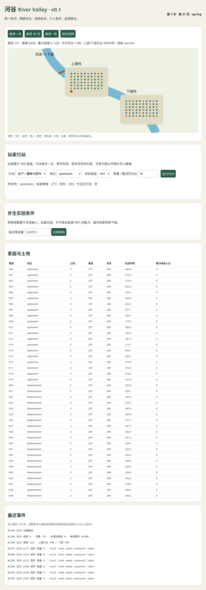

# 河谷 River Valley · v0.1

按日演化的虚拟社会实验：两座村庄、一条河、40 户、120 名固定身份居民及 1 名玩家。家庭库存、土地、水、劳动和交易构成可执行的因果闭环。无人操作时 NPC 仍会生产、消费、交易和互助；没有预写冲突剧情。

需要 **Python 3.12**；模拟、CLI、HTTP 服务和自动测试全部使用标准库，无需安装第三方依赖。模拟核心不导入 UI，也不使用真实时间。

## 运行

在仓库根目录执行：

```bash
# 一条命令模拟十年（每年 360 天）
python -m river_valley simulate --years 10 --scenario normal --seed 42

# 第三至第五年降雨为正常情景的四分之一
python -m river_valley simulate --years 10 --scenario drought --seed 42

# 按日推进、指定输出目录
python -m river_valley simulate --days 1 --output runs/one-day

# 自动测试
python -m unittest discover -v

# 二维地图与交互控制
python -m river_valley serve --port 8000
```

在本机浏览器访问服务的 8000 端口。默认只监听本机；远程使用需配置端口转发。界面显示居民位置、土地与库存、时间及最近事件，可推进时间，进行玩家行动或调整外生降雨。每次修改均写入日志并更新快照。



输出包括 `summary.json`、完整 `events.jsonl`、可续跑的 `snapshot.json` 和年度 `year-NN.json`。默认 `runs/` 目录有唯一时间后缀；显式 `--output` 会替换同名输出文件，请勿覆盖要保留的实验。`--no-events` 可加速探索，但不能完整重放。内存只保留最近 500 个事件，完整日志直接写入文件。

## 干预与统一行动 API

```python
from river_valley import Action, World

world = World(seed=42, scenario="normal")
world.act(Action("player", "transfer", target="h01", amount=50))
world.advance(1)
world.act(Action("player", "divert", amount=100))
world.advance(90)
print(world.summary())
```

`World.act` 是玩家和 NPC 的唯一行动入口。每人每天最多成功行动一次；失败不修改状态或消耗额度。

| 行动 | 规则 |
| --- | --- |
| `move` | 到另一村庄，消耗当日行动；位置立即改变 |
| `produce` | 在自家土地所在地播种或耕作；每户每天一份劳动，播种消耗 3 单位独立种粮 |
| `trade` | 从同村家庭的公开余粮报价买入，1 粮食 = 1 货币；双方粮食和货币同步结算 |
| `transfer` | 把自家粮食转给同村另一户 |
| `divert` | 自家在上游且本人在上游时操作闸门，0–100%；100% 设置将 90% 河水分配到上游渠道 |

玩家属于 h00，与三名 NPC 共用家庭仓库。移动不搬运整个家庭仓库；离家不能生产或操作家庭粮食。上游 NPC 可以调用同样的闸门 API，但默认策略不主动截流。降雨调节属于**外生实验输入**，不是玩家或 NPC 能力。

用 JSON 文件安排干预，按文件顺序在指定日的 NPC 行动前执行：

```bash
python -m river_valley simulate --years 10 --inputs examples/divert.json
python -m river_valley simulate --years 10 --inputs examples/transfer.json
python -m river_valley simulate --years 10 --inputs examples/rainfall.json
```

格式示例（`day=0` 是第一天，`value: null` 恢复场景降雨）：

```json
[
  {"day": 0, "type": "action", "actor": "player", "kind": "divert", "amount": 100},
  {"day": 720, "type": "rainfall", "value": 15},
  {"day": 1800, "type": "rainfall", "value": null}
]
```

非法干预报错并返回非零退出状态，不会悄悄忽略；先前已经完成的输入或天数仍会留在日志。

## 重放与续跑

```bash
# 验证日志并重建最终状态
python -m river_valley replay runs/<实验目录>/events.jsonl

# 重建第 720 天开始的状态并保存
python -m river_valley replay runs/<实验目录>/events.jsonl --day 720 --save runs/day720.json

# 从快照继续交互运行
python -m river_valley serve --load runs/day720.json --output runs/resumed
```

`--day 0` 返回初始状态，其他日期返回该日输入执行前的状态。重放只应用记录的变化，不重新运行 NPC 或天气。续跑日志为 `segment-*.jsonl`，ID 和哈希接续快照。完整重放需要原始日志到该快照的**精确前缀**，再按顺序拼接片段；若原日志包含快照之后的事件，不能直接连接整个原日志。

每条事件包含时间、行动者、直接来源、详情、带 `before/after` 的路径变化及哈希链。转移记录双方扣增；作物增长指向劳动及水文事件；水文记录最近的气候及截流输入 ID。哈希链检测修改和中间缺失，不是数字签名；合法前缀也能重放，请对照摘要的天数、事件数与 `state_hash` 判断是否完整。

## 模型与边界

每日顺序：外部输入 → NPC 行动 → 降雨分水 → 作物生长/收获 → 种粮留存 → 食用消费 → 时钟推进。每季 90 天，春秋前 30 天播种、季末收获。有播种、劳动和灌溉才增加作物。详细参数和账本公式见 [模型说明](docs/model.md)。

NPC 只观察自家状态和当前村庄的公开售粮/求助信息，不知道未来天气或异地库存。每户农民按农时劳动，商人在低库存时买粮，照料者在有余粮时响应本地求助。

价格、土地、身份固定；个人旅行不携带货物。缺食缺水累计为指标，尚无疾病、死亡、出生或迁户。粮食不腐败，土地不退化，正常情景会持续囤粮。每户另有 3 单位种粮储备：收获先补种粮，余粮进入食用库存；收获不足时，在每日消费前用食用粮补种粮。连续干旱仍可耗尽食用粮，但口粮消费不会侵蚀尚存的种粮；没有食用粮或种粮时也没有外部补种路径。这是本版模型约束，不能解读为真实社会的必然结果。

观测只生成摘要、日志和地图；没有稳定度、战争触发器、修仙或 LLM NPC。四组十年实验、重放验证、性能和下一阶段建议见 [实验结果](docs/experiments.md)。
